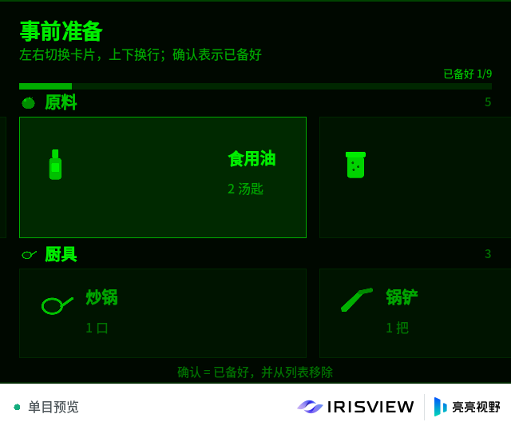
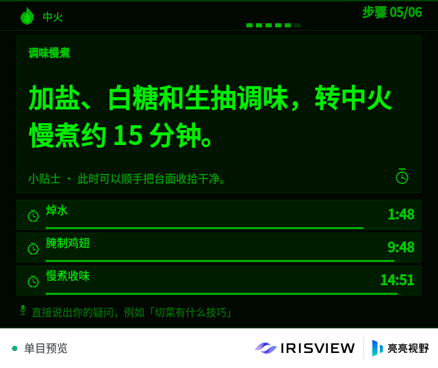

# Kitchen Helper — IrisView AR 眼镜 TypeScript 开发工具链

基于工作区内 **IrisView Developer Kit v1.0.0**（`IrisView-Developer-Kit-v1.0.0/`）与
**IrisView 平台开发文档**（`IrisView-Platform-Alpha-中英双语版-v3/`）构建的 TypeScript
开发工具链。目标应用是运行在 IrisView Client / 模拟器中的 FusionUI AR 应用；工具链把
官方文档里手工的 `tsc + esbuild` 流程自动化，并在 **Fedora 44** 上完成了从脚手架、类型检查、
打包到模拟器呈现真实帧的端到端验证。

工具链本身用 TypeScript 编写（`packages/toolchain`），可直接由 Node.js 24 运行；应用侧
TypeScript 通过 Vite/Rolldown 打包为 Client 需要的 CommonJS 入口。

工作区自带的 **Kitchen Helper** 已实现完整的 AR 做菜引导 MVP：首页推荐 → 文字模拟语音点菜 →
HowToCook 拉取 + DeepSeek 结构化 → 菜谱信息 → 大卡片事前准备 → 分步引导（火候、叠加倒计时、
助手问答弹窗）→ 完成页。详细说明见
[apps/kitchen-helper/README.zh-CN.md](apps/kitchen-helper/README.zh-CN.md) 与
[docs/kitchen-helper.zh-CN.md](docs/kitchen-helper.zh-CN.md)。

赛题提交材料：2 页作品说明 [docs/kitchen-helper-brief.zh-CN.pdf](docs/kitchen-helper-brief.zh-CN.pdf)、
演示视频口播稿 [docs/demo-voiceover.zh-CN.md](docs/demo-voiceover.zh-CN.md)，延迟原始数据在
[docs/measurements/](docs/measurements/)。

| 首页                                                   | 事前准备                                               | 步骤页                                                    |
| ------------------------------------------------------ | ------------------------------------------------------ | --------------------------------------------------------- |
|  |  |  |

## 功能

| 能力                                 | 说明                                                                                  |
| ------------------------------------ | ------------------------------------------------------------------------------------- |
| `ivt new`                            | 创建 TypeScript 应用：`app-src/` 源码、`src/XRManifest.xml`、类型声明映射、单测骨架   |
| `ivt build`                          | `tsc --noEmit` + Vite/Rolldown 打包成 `src/index.js`（CJS，`@irisview/osx/*` 外部化） |
| `ivt test`                           | 类型检查 + `node --test` 运行 TS 单测 + SDK 源码校验                                  |
| `ivt package` / `ivt verify`         | 调用 Developer Kit SDK 生成并校验 `.fuiapp` 应用包                                    |
| `ivt run` / `ivt dev`                | 在模拟器中安装并运行应用（dev = build + package + run）                               |
| `ivt smoke`                          | 端到端验收：构建、打包、启动模拟器并等待真实应用帧出现                                |
| `ivt doctor`                         | 环境自检，并在必要时修复 Kit 完整性元数据（见下文）                                   |
| `ivt state` / `deploy` / `uninstall` | 委托官方 SDK 的对应命令                                                               |

## 环境要求

| 依赖             | 版本 / 说明                                                              |
| ---------------- | ------------------------------------------------------------------------ |
| Node.js          | **24.13.0**（工具链会自动使用 Vite+ 管理的 runtime，见 `.node-version`） |
| npm              | **11.6.2**（随 Node 24.13.0；SDK 会严格校验）                            |
| Python 3         | 运行官方 SDK（`python3`）                                                |
| IrisView Kit     | `IrisView-Developer-Kit-v1.0.0/`，可用 `IRISVIEW_KIT_ROOT` 指定其他位置  |
| 图形会话         | `DISPLAY` 或 `WAYLAND_DISPLAY`；`ivt smoke` 在 Xvfb 可用时优先使用 Xvfb  |
| 操作系统（官方） | Ubuntu 22.04 / 26.04 x86_64（Fedora 44 已实测可用，见兼容层）            |

> **Fedora 说明**：Kit 只声明支持 Ubuntu，本工具链通过内存中的宿主判定覆盖、Node/npm 精确固定、
> Kit 完整性元数据归一化等方式跳过正式检查。官方 Kit 目录本身保持原样（完整性修复只重写哈希元数据，
> 且首代文件备份在 `IrisView-Developer-Kit-v1.0.0/.integrity-backup/`）。完整原理见
> [docs/fedora-compatibility.md](docs/fedora-compatibility.md)。

> **离线环境说明**：本工作区已预置 `node_modules`（含 TypeScript 7、Vite+ 1.5、Vite/Rolldown），
> 可直接运行上述命令，无需联网安装。联网后可执行 `vp install` 刷新锁文件（`pnpm-workspace.yaml`
> 已声明 `packages/*`、`apps/*` 两个 workspace 成员）；离线沙箱内 pnpm store 为只读，安装会被拒绝。

## 快速开始

```bash
# 1. 环境自检（首次运行会修复 Kit 中被重新格式化文件失效的哈希元数据）
node packages/toolchain/src/cli.ts doctor

# 2. 构建工作区自带的 Kitchen Helper AR 应用
node packages/toolchain/src/cli.ts build apps/kitchen-helper
node packages/toolchain/src/cli.ts test apps/kitchen-helper
node packages/toolchain/src/cli.ts package apps/kitchen-helper

# 3. 在模拟器中运行（关闭 Client 窗口或 Ctrl+C 结束）
#    --state-dir 把整套隔离状态（含应用私有数据）放进项目目录
node packages/toolchain/src/cli.ts run --latest --project apps/kitchen-helper \
  --state-dir apps/kitchen-helper/sim-state

# 4. 无人值守端到端验收：等待模拟器呈现第一帧
node packages/toolchain/src/cli.ts smoke apps/kitchen-helper
```

也可以使用 Vite Task（`package.json` 脚本与 Vite Task 均可）：

```bash
vp run doctor
vp run app:build
vp run app:package
vp run app:run
vp run sim:smoke        # 端到端验收
vp run kit:repair       # 强制修复 Kit 哈希元数据
```

`--state-dir` 按平台文档《模拟器数据区域的指定与读取》隔离整套模拟器状态；应用侧只通过
Host 提供的 `FUSIONUI_APP_DATA_DIR` 访问自己的私有目录。Kitchen Helper 的 DeepSeek Key
就放在该私有目录的 `deepseek-key.txt`（首次运行日志会打印 `KITCHEN_HELPER_DATA_DIR` /
`KITCHEN_HELPER_LLM_KEY` 指向的路径），运行时读取、不进入 `.fuiapp`；`sim-state/` 已被
git 忽略。`vp run app:run` 已默认带上该 `--state-dir`。

创建一个新项目：

```bash
node packages/toolchain/src/cli.ts new ../my-ar-app \
  --id com.example.myapp --name "My AR App" --name-zh "我的 AR 应用"
cd ../my-ar-app
ivt build && ivt test && ivt package && ivt run --latest
```

## 仓库结构

```text
.
├── packages/toolchain/           # @kitchen-helper/ivt：TypeScript 工具链
│   ├── src/
│   │   ├── cli.ts                # 命令入口（node 直接运行 TS）
│   │   ├── commands/             # doctor/new/build/test/package/run/dev/smoke/state...
│   │   ├── compat/integrity.ts   # Developer Kit 完整性元数据检查与修复
│   │   ├── sdk.ts                # 官方 Python SDK 桥接、Node/npm 固定、宿主兼容环境
│   │   ├── build.ts              # tsc 类型检查 + Vite/Rolldown CJS 打包
│   │   ├── scaffold.ts           # TS 应用脚手架
│   │   └── project.ts            # 应用工程模型与校验
│   ├── assets/irisview_host_compat.py  # 非 Ubuntu 宿主判定的内存覆盖器
│   ├── templates/ts-app/         # `ivt new` 模板
│   └── tests/                    # Vitest 单元测试
├── apps/kitchen-helper/          # Kitchen Helper AR 应用（完整通过打包与模拟器验证）
│   ├── app-src/                  # TS 源码：状态机、HowToCook/DeepSeek 流水线、UI
│   ├── docs/screenshots/         # 模拟器截图
│   ├── src/                      # XRManifest.xml、图标资源、构建产物 index.js
│   ├── tests/                    # node --test 单元测试（状态机 / 解析器 / 降级）
│   ├── tools/                    # 图标生成脚本
│   └── README.md / README.zh-CN.md
├── docs/
│   ├── fedora-compatibility.md   # Fedora 兼容层原理与验证
│   ├── kitchen-helper.md         # 厨房助手设计说明（英文）
│   ├── kitchen-helper.zh-CN.md   # 厨房助手设计说明（中文）
│   ├── toolchain.md              # CLI、构建流水线、状态目录、环境变量
│   ├── demo-voiceover.zh-CN.md   # 演示视频口播稿（30/60/90 秒）
│   ├── kitchen-helper-brief.zh-CN.pdf  # JUNCTION 赛题 2 页作品说明
│   └── measurements/             # 延迟测量协议、CSV 与原始日志
├── vite.config.ts                # Vite+ 格式/检查/任务配置
└── tsconfig.json                 # 工具链类型检查配置
```

## 构建流水线

官方 SDK 不编译 TypeScript，也不执行 npm scripts；它接收“已经构建好的 JavaScript 源码目录”。
工具链据此分成两个阶段：

```text
app-src/index.ts ──tsc --noEmit──> 类型检查
        │
        └──Vite/Rolldown(bundle, CJS, node24)──> src/index.js
                                                  │
              src/XRManifest.xml + 资源 ─────────┤
                                                  ▼
                        irisview build   → dist/{linux,android}/
                        irisview package → *.fuiapp (debug-unsigned / signed)
                        irisview run     → 模拟器安装、启动、呈现应用帧
```

打包时 `@irisview/osx/*`、`@fusionui/*` 与 Node 内置模块保持为运行时外部引用（由 Client 提供），
其余应用模块和第三方库被打进 `src/index.js`；这与文档中 `esbuild --external:@irisview/osx/*`
的约定一致，但不需要在应用工程里安装 esbuild。

## 验证结果（Fedora 44）

| 检查项                                         | 结果                                            |
| ---------------------------------------------- | ----------------------------------------------- |
| `ivt doctor`                                   | pass（host override active，Node/npm 精确匹配） |
| `ivt build apps/kitchen-helper`                | pass（类型检查 + 160.2 KiB CJS bundle）         |
| `ivt test apps/kitchen-helper`                 | pass（9 个测试文件、61 个测试用例 + SDK 校验）  |
| `ivt package apps/kitchen-helper`              | pass（`.fuiapp`，debug-unsigned，323.3 KiB）    |
| `ivt verify <artifact> --allow-debug-unsigned` | pass（结构与信任关系校验）                      |
| `ivt smoke apps/kitchen-helper`                | pass（`IrisView application frame 1`）          |
| `ivt new` + build/test/package/verify/smoke    | pass（脚手架应用同样在模拟器呈现第一帧）        |
| `vp test` / `vp check` / `vp run app:build`    | pass                                            |

示例应用运行日志（模拟器侧）：

```text
KITCHEN_HELPER_DATA_DIR {"path":".../sim-state/applications/data/com.example.kitchenhelper"}
KITCHEN_HELPER_LLM_KEY {"source":"file","file":".../deepseek-key.txt","model":"deepseek-flash"}
KITCHEN_HELPER_LIFECYCLE {"lifecycle":0}
KITCHEN_HELPER_READY {"language":"zh","navigation":true,"completed":0}
KITCHEN_HELPER_TEXT {"text":"红烧肉","screen":"home","at":1794051234567}
KITCHEN_HELPER_SCREEN {"screen":"loading","step":null,"dish":null}
KITCHEN_HELPER_LATENCY {"requestId":1,"dish":"简易红烧肉","source":"deepseek","steps":11,
  "inputToPipelineMs":14639,"pipelineToScreenMs":7,"inputToScreenMs":14646,"minLoadingWaitMs":0}
KITCHEN_HELPER_RECIPE {"title":"简易红烧肉","steps":11,"source":"deepseek","ingredients":14}
IrisView application frame 1: content=1 leftHash=... leftLit=307200 rightLit=307200
```

应用还通过文字注入验证了异常路径：输入 `*` 会进入 `forced` 异常页。未配置
`DEEPSEEK_API_KEY` 时走本地解析器；配置后菜谱信息页会显示 `DeepSeek 结构化`。

## 延迟实测与可观测日志

应用启动后会在模拟器 stdout 输出结构化日志，便于验收与复现：

| 日志                        | 用途                                                                       |
| --------------------------- | -------------------------------------------------------------------------- |
| `KITCHEN_HELPER_LATENCY`    | 输入 → 结构化 → 菜谱页应用的时延（requestId、dish、source、steps、毫秒数） |
| `KITCHEN_HELPER_FALLBACK`   | 检索 / 读取 / 模型降级的原因（stage、reason，含 error cause 链）           |
| `KITCHEN_HELPER_HTTP_RETRY` | GET 重试记录（url、attempt、status）                                       |

HowToCook 的 GET 请求在网络错误、429 与 5xx 时自动重试 3 次；模型侧退回本地解析或离线快照。
2026-11-07 在模拟器 release/off、单目 640×480 下连续测量 11 次，10 次成功：输入 → ARUI 更新
最小 **9.8 s**、中位 **12.7 s**、P95 / 最大 **16.5 s**，10 次均由 DeepSeek 结构化；另 1 次超过
测量脚本 60 s 上限记为失败。测量协议、CSV 与逐次原始日志见 [docs/measurements/](docs/measurements/)。

## 已知限制

- 非 Ubuntu 主机属于**未声明支持**路径：本工具链只覆盖运行与调试所需检查，真实眼镜/Android
  Client 的部署仍应在官方支持的 Ubuntu 环境或厂商支持的 Client 上验证。
- Kit 完整性修复会重写 `SHA256SUMS`、`profiles.json`、`application-api/manifest.json`、
  `PACKAGE_INFO.txt` 与 compatibility container 哈希字段；不改动二进制与 JS 语义，首次修复前
  备份原始文件。详见兼容性文档。
- 模拟器会话不支持热重载；修改代码后重新执行 `ivt dev`（或 build/package/run）。
- `ivt smoke` 在本机沙箱中 Xvfb 不可用时会回退到当前图形会话；CI 中请确保 Xvfb 可用或使用
  带显示器的 runner。
- Kitchen Helper MVP 不接入 ASR/TTS，语音通道未实现，全部交互与演示均通过模拟器文字通道
  完成；DeepSeek Key 只是开发占位符，不应把真实 Key 打进 `.fuiapp`；模拟器 profile 会拒绝
  原生 `AnimationPlayback`，应用改用帧驱动透明度动画（渐入、脉冲、进度条、波形、彩带）。
- 应用依赖联网检索与 DeepSeek；网络抖动已通过 GET 重试与本地解析 / 离线快照兜底，但
  「语音与文本跨方式切换、独立纠正」尚未实现，赛题材料中已按规划标注。
