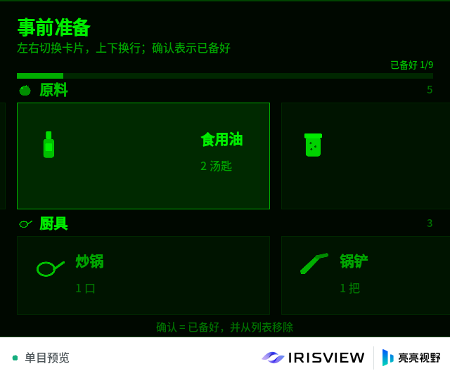
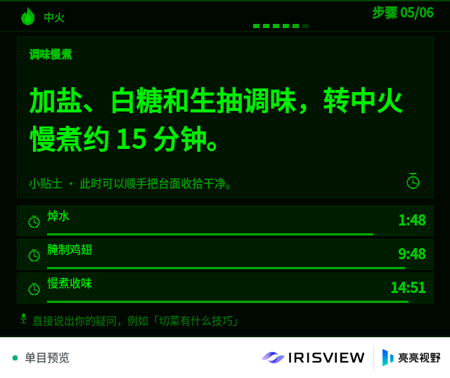
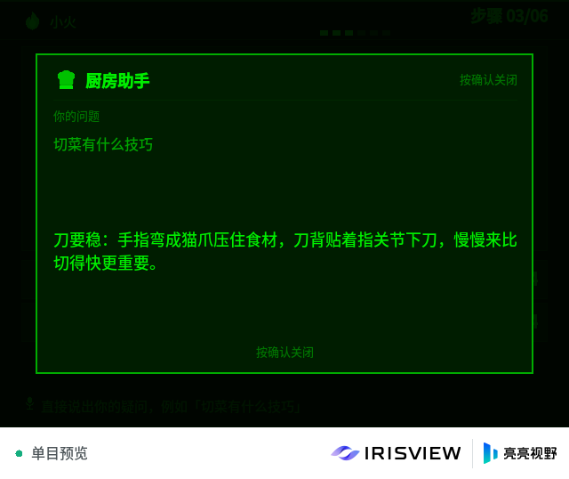
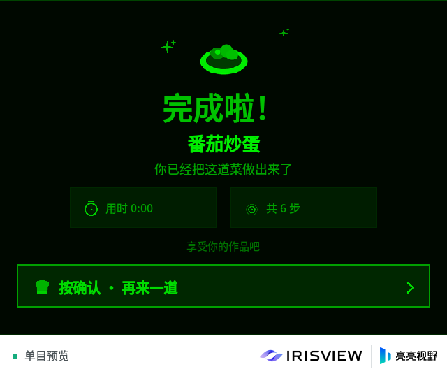
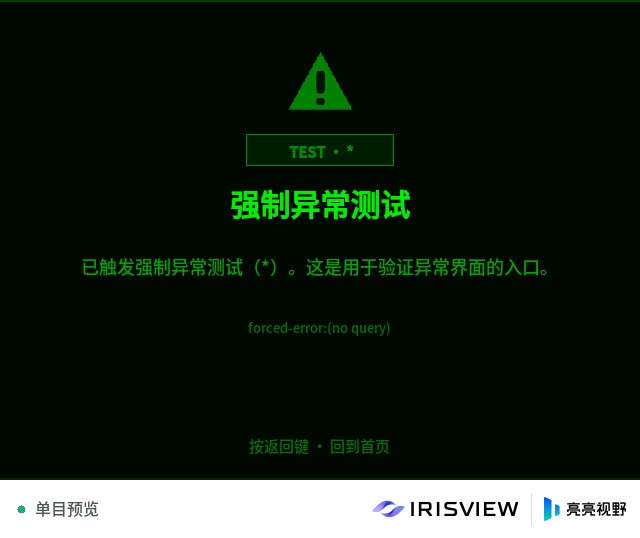

# Kitchen Helper — IrisView AR cooking assistant

[中文](README.zh-CN.md) | English

An AR cooking coach for absolute beginners, built with the TypeScript toolchain in this
repository and rendered inside the IrisView Client / simulator.

The MVP covers the whole loop:

1. Home: recommended beginner dishes, then press confirm and "say" (type) the dish you want.
2. Loading: fetch the recipe from [HowToCook](https://github.com/Anduin2017/HowToCook) and
   structure it with DeepSeek (or the bundled local parser when no key is configured).
3. Recipe summary: difficulty, time, servings, calories and ingredient/tool/step counts.
4. Preparation: large ingredient and cookware cards; confirm an item to mark it ready.
5. Cooking: one big step at a time, heat indicator, stacked countdown bars, and a
   voice-like question box answered by the assistant.
6. Done: congratulations, cooking time and step count.

| Screen                                       | What it shows                      |
| -------------------------------------------- | ---------------------------------- |
|            | Home with beginner picks           |
|     | Ingredient and cookware cards      |
|      | Step, heat icon and stacked timers |
|  | Assistant answer modal             |
|            | Completion screen                  |
|          | Forced error (`*`) screen          |

> Screenshots come from the simulator's green monochrome preview (640×480, left eye).

## Interaction model

The glasses deliver temple input as navigation actions:

| Action           | Behaviour                                                  |
| ---------------- | ---------------------------------------------------------- |
| `activate` (tap) | confirm / start timer / next step / remove a ready card    |
| `up` / `down`    | switch rows on preparation, scroll the step page           |
| `left` / `right` | move between cards, next / previous cooking step           |
| `back`           | previous screen, close the assistant modal, home from done |

**This MVP has no ASR.** Voice is simulated with text through the simulator input box or
`FUSIONUI_DEMO_TEST_USER_TEXT`. The same text channel also accepts explicit commands so the
whole app can be demonstrated without a temple device:

```text
确认 | 确定 | ok | enter      -> activate
上 下 左 右 | up down left right
返回 | back                   -> back
*                             -> force one task error (the special test point)
```

Any other text is treated as a dish name on Home/Listening, or as a question while Cooking.

## Recipe pipeline

```text
user text
   │
   ▼
HowToCook search ──► detail page ──► canonical Markdown via GitHub contents API
   │                                      │
   │                                      ▼
   │                         DeepSeek chat (JSON structured output)
   │                                      │
   │                     no key / failure ▼
   │                         deterministic local Markdown parser
   ▼                                      │
built-in offline snapshots (3 dishes) ◄────┘
   │
   ▼
prep cards → cooking steps + timers → done
```

- Search and detail pages are fetched from `https://howtocook.aiursoft.com` with the Chinese
  culture cookie.
- The Markdown is read through the GitHub contents API because `raw.githubusercontent.com`
  is not reachable from every network.
- If GitHub fails, the visible detail-page text is used instead.
- Three beginner recipes (番茄炒蛋 / 可乐鸡翅 / 酸辣土豆丝) are embedded as fully structured
  snapshots so the demo works offline.

## DeepSeek API key and the state directory

The key is read **at runtime** from the application's private data directory, never from the
bundle. `vp run app:run` starts the simulator with a project-local isolated state directory
(`--state-dir apps/kitchen-helper/sim-state`). Per the platform guide, the app never parses
`--state-dir`; it only addresses its own data through `FUSIONUI_APP_DATA_DIR`, wrapped by
[`app-src/application-data.ts`](app-src/application-data.ts).

The first run prints the exact file to create:

```text
KITCHEN_HELPER_DATA_DIR {"path":".../sim-state/applications/data/com.example.kitchenhelper"}
KITCHEN_HELPER_LLM_KEY {"source":"none","file":".../applications/data/com.example.kitchenhelper/deepseek-key.txt","model":"deepseek-chat"}
```

The app seeds that `deepseek-key.txt` with a comment template when it is missing. Paste
`sk-...` into it (blank lines and `#` comments are ignored) and
restart the app; `KITCHEN_HELPER_LLM_KEY` then reports `"source":"file"`. When set, the
`DEEPSEEK_API_KEY` environment variable still wins, and `app-src/config.ts` keeps a
development placeholder for quick experiments. `sim-state/` is git-ignored.

Without a key the app still works: the recipe header says “本地解析（未配置 Key）” and the
cooking modal answers from a local tip library.

> ⚠️ A key embedded in a `.fuiapp` (for example via `app-src/config.ts`) is readable by
> anyone with the package. The runtime key file never enters the package; production must
> proxy short-lived tokens through a backend.

## Build, test and run

From the workspace root:

```bash
node packages/toolchain/src/cli.ts build apps/kitchen-helper   # tsc + CJS bundle
node packages/toolchain/src/cli.ts test apps/kitchen-helper    # typecheck + node:test + SDK validation
node packages/toolchain/src/cli.ts package apps/kitchen-helper # .fuiapp
node packages/toolchain/src/cli.ts run --latest --project apps/kitchen-helper \
  --state-dir apps/kitchen-helper/sim-state                   # isolated project-local state
node packages/toolchain/src/cli.ts smoke apps/kitchen-helper   # waits for a real presented frame
```

`vp run app:build`, `app:test`, `app:package`, `app:run` and `sim:smoke` run the same steps;
`app:run` already passes `--state-dir apps/kitchen-helper/sim-state`.

To force the error screen automatically:

```bash
FUSIONUI_DEMO_TEST_USER_TEXT='*' \
  node packages/toolchain/src/cli.ts run --latest --project apps/kitchen-helper \
  --state-dir apps/kitchen-helper/sim-state
```

To simulate saying a dish:

```bash
FUSIONUI_DEMO_TEST_USER_TEXT='番茄炒蛋' \
  node packages/toolchain/src/cli.ts run --latest --project apps/kitchen-helper \
  --state-dir apps/kitchen-helper/sim-state
```

## Architecture

| Path                              | Purpose                                                                    |
| --------------------------------- | -------------------------------------------------------------------------- |
| `app-src/index.ts`                | Window, frame loop, input polling, async effect execution, lifecycle logs  |
| `app-src/application-data.ts`     | Private data directory from `FUSIONUI_APP_DATA_DIR` per the platform guide |
| `app-src/config.ts`               | DeepSeek key resolution (env / runtime file / placeholder), endpoints      |
| `app-src/model/types.ts`          | Recipe / screen / timer domain types                                       |
| `app-src/model/state.ts`          | Pure reducer: screens, prep focus, countdown rules, assistant modal        |
| `app-src/model/i18n.ts`           | Bilingual copy and formatting helpers                                      |
| `app-src/recipe/howtocook.ts`     | Search, detail page and Markdown adapter                                   |
| `app-src/recipe/llm.ts`           | DeepSeek structuring + Q&A prompts, JSON normalization                     |
| `app-src/recipe/local-extract.ts` | Offline Markdown → recipe parser                                           |
| `app-src/recipe/service.ts`       | Pipeline orchestration and fallbacks                                       |
| `app-src/recipe/recommended.ts`   | Home picks and three offline snapshots                                     |
| `app-src/ui/*.ts`                 | Screens, theme, icons, frame-driven micro-animations                       |
| `src/assets/icons/*.png`          | Generated 96×96 icon set                                                   |
| `tools/generate-icons.py`         | Reproducible icon generator                                                |
| `tests/`                          | Reducer, parser, LLM normalization and fallback tests                      |
| `docs/`                           | Additional design notes and screenshots                                    |

Only `app-src/index.ts` is bundled; FusionUI/OS modules stay external and are provided by
the Client. `src/index.js` is generated — do not edit it by hand.

## Testing

`node packages/toolchain/src/cli.ts test apps/kitchen-helper` runs 6 test files (43 tests):

- home → listening → loading → recipe → prep → cooking → done/error transitions;
- confirm-vs-timer priority and overlapping timers across steps;
- prep focus/removal/ready logic;
- Markdown timer/heat/icon extraction for three real HowToCook recipes;
- DeepSeek JSON validation/clamping and offline fallbacks;
- runtime DeepSeek key resolution from the state directory (env wins, comments ignored);
- `*` forced error and text command parsing.

`smoke` starts the simulator, installs the package and waits for a presented application
frame; it is the end-to-end acceptance check.

## Known MVP limitations

- No ASR or TTS: voice is simulated with text, as required by the MVP brief.
- Navigation actions are read from `takeNavigationAction`; automated text flows rely on the
  simulator text injection hook.
- The simulator's native `AnimationPlayback` backend rejects clips, so animations are driven
  from the app clock (opacity fades, pulses, progress bars, waveform, confetti).
- The simulator's composition proof rejects frames that combine position animation with
  style/opacity changes (or that re-render text inside a moved parent) with
  `Composition geometry proof rejected`: the Client then reports the app as needing attention
  and stops accepting input. The home carousel therefore keeps two fixed card slots and swaps
  their contents instead of sliding them. See
  [the design notes](../../docs/kitchen-helper.md#rendering-and-animation).
- Network access from the simulator is assumed; when it is unavailable, only the three
  embedded recipes work.
- The real glasses deployment path is outside this MVP's scope.
