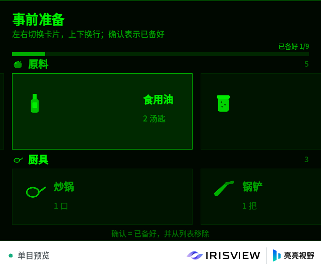
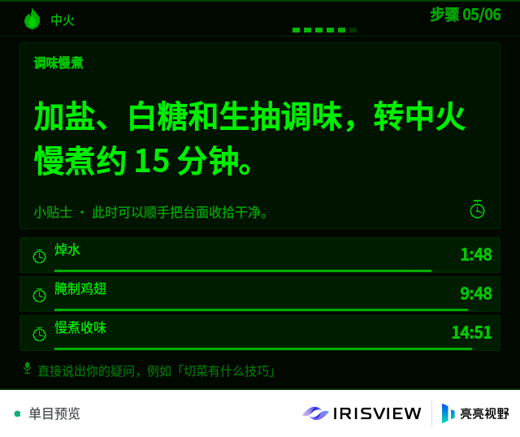
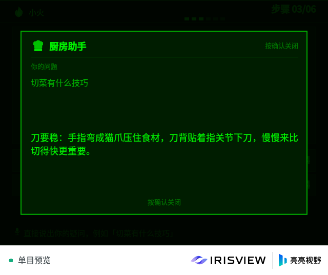
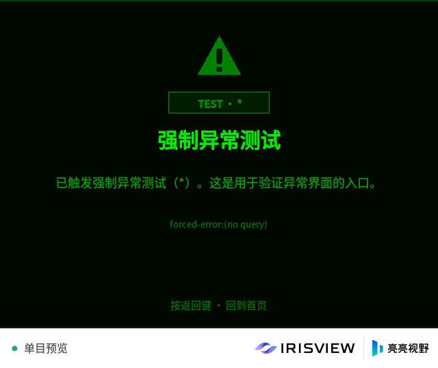

# 厨房助手 — IrisView AR 烹饪引导应用

[English](README.md) | 中文

面向厨房小白的 AR 烹饪助手，使用本仓库的 TypeScript 工具链构建，运行在 IrisView
Client / 模拟器中。

MVP 覆盖完整流程：

1. 准备页：展示新手推荐菜谱；按确认后用“语音”（文字模拟）说出想做的菜。
2. 加载页：从 [HowToCook](https://github.com/Anduin2017/HowToCook) 拉取菜谱，交给 DeepSeek
   做结构化提取（未配置 Key 时使用内置本地解析器）。
3. 菜谱信息页：难度、用时、份量、热量，以及原料 / 厨具 / 步骤数量。
4. 事前准备页：大卡片展示原料与厨具；按确认表示已备好并从列表移除。
5. 步骤页：醒目的大字操作步骤、火候图标、可叠加的倒计时条；文字提问由助手弹窗回答。
6. 完成页：祝贺完成，显示用时与步骤数。

| 页面                                        | 内容                       |
| ------------------------------------------- | -------------------------- |
|         | 首页与新手推荐             |
|       | 原料与厨具卡片             |
|      | 大字步骤、火候与叠加倒计时 |
|  | 助手回答弹窗               |
|         | 完成页                     |
|        | 强制异常（`*`）页          |

> 截图来自模拟器单目预览（640×480，左眼，绿色单色显示）。

## 交互方式

眼镜腿输入被映射为导航动作：

| 动作                   | 行为                                          |
| ---------------------- | --------------------------------------------- |
| `activate`（点按确认） | 确认 / 开始倒计时 / 下一步 / 移除已备好的卡片 |
| `up` / `down`          | 切换原料与厨具行；滚动步骤页                  |
| `left` / `right`       | 卡片焦点左右移动；下一步 / 上一步             |
| `back`                 | 返回上一页、关闭助手弹窗、从完成页回首页      |

**本 MVP 不接入 ASR。** 语音用模拟器输入框或 `FUSIONUI_DEMO_TEST_USER_TEXT` 的文字模拟。
同一个文字通道也接受显式命令，方便在没有眼镜腿设备时完整演示：

```text
确认 | 确定 | ok | enter      -> 确认
上 下 左 右 | up down left right
返回 | back                   -> 返回
*                             -> 强制触发一次任务异常（特殊测试点）
```

其他文字在首页/聆听页会被当成菜名，在步骤页会被当成向助手提出的问题。

## 菜谱流水线

```text
用户文字
   │
   ▼
HowToCook 搜索 ──► 详情页 ──► 通过 GitHub contents API 读取 Markdown
   │                                      │
   │                                      ▼
   │                         DeepSeek（JSON 结构化输出）
   │                                      │
   │                       无 Key / 失败 ▼
   │                         确定性本地 Markdown 解析器
   ▼                                      │
内置离线菜谱快照（3 道） ◄──────────────────┘
   │
   ▼
准备卡片 → 步骤与倒计时 → 完成
```

- 搜索与详情页使用中文 culture cookie 请求 `https://howtocook.aiursoft.com`。
- Markdown 通过 GitHub contents API 读取，因为部分网络无法直连 `raw.githubusercontent.com`。
- GitHub 失败时退回到详情页可见文本。
- 番茄炒蛋 / 可乐鸡翅 / 酸辣土豆丝三道菜内置为完整结构化快照，离线也能演示。

## DeepSeek API Key 与状态目录

Key 在**运行时**从应用私有数据目录读取，不会进入 bundle。`vp run app:run` 会用项目内的
隔离状态目录启动模拟器（`--state-dir apps/kitchen-helper/sim-state`）。按平台文档，应用
不解析 `--state-dir`，只通过 Host 提供的 `FUSIONUI_APP_DATA_DIR`（由
[`app-src/application-data.ts`](app-src/application-data.ts) 封装）访问自己的数据。

首次运行会打印需要创建的文件：

```text
KITCHEN_HELPER_DATA_DIR {"path":".../sim-state/applications/data/com.example.kitchenhelper"}
KITCHEN_HELPER_LLM_KEY {"source":"none","file":".../applications/data/com.example.kitchenhelper/deepseek-key.txt","model":"deepseek-flash"}
```

应用首次运行会自动生成带注释模板的 `deepseek-key.txt`。把 `sk-...` 粘贴进去
（空行与 `#` 注释会被忽略）并重启应用，
`KITCHEN_HELPER_LLM_KEY` 会显示 `"source":"file"`。`DEEPSEEK_API_KEY` 环境变量仍然优先；
`app-src/config.ts` 保留一个开发占位符用于快速试验。`sim-state/` 已被 git 忽略。

未配置 Key 时应用仍可用：菜谱页显示“本地解析（未配置 Key）”，步骤页提问由本地提示库回答。

DeepSeek 调用关闭思考模式并显式设置预算（结构化 90 秒 / 8K tokens，问答 30 秒 / 1K）；超时
覆盖整个响应体；JSON Output 空载荷、`finish_reason=length` 截断或 JSON 解析失败会重试一次，
仍失败才降级到内置快照 / 本地解析器。

> ⚠️ 打进 `.fuiapp` 的 Key（例如通过 `app-src/config.ts`）对拿到安装包的人可见。运行时
> Key 文件不会进入安装包；生产环境仍应通过后端代理下发短期令牌。

## 构建、测试与运行

在工作区根目录执行：

```bash
node packages/toolchain/src/cli.ts build apps/kitchen-helper   # tsc + CJS bundle
node packages/toolchain/src/cli.ts test apps/kitchen-helper    # 类型检查 + node:test + SDK 校验
node packages/toolchain/src/cli.ts package apps/kitchen-helper # .fuiapp
node packages/toolchain/src/cli.ts run --latest --project apps/kitchen-helper \
  --state-dir apps/kitchen-helper/sim-state                   # 隔离的项目内状态目录
node packages/toolchain/src/cli.ts smoke apps/kitchen-helper   # 等待真实应用帧呈现
```

`vp run app:build`、`app:test`、`app:package`、`app:run`、`sim:smoke` 等价；
`app:run` 已经带上 `--state-dir apps/kitchen-helper/sim-state`。

自动触发异常页：

```bash
FUSIONUI_DEMO_TEST_USER_TEXT='*' \
  node packages/toolchain/src/cli.ts run --latest --project apps/kitchen-helper \
  --state-dir apps/kitchen-helper/sim-state
```

自动模拟说出一道菜：

```bash
FUSIONUI_DEMO_TEST_USER_TEXT='番茄炒蛋' \
  node packages/toolchain/src/cli.ts run --latest --project apps/kitchen-helper \
  --state-dir apps/kitchen-helper/sim-state
```

## 代码结构

| 路径                              | 用途                                                   |
| --------------------------------- | ------------------------------------------------------ |
| `app-src/index.ts`                | 窗口、帧循环、输入轮询、异步 effect 执行、生命周期日志 |
| `app-src/application-data.ts`     | 按平台文档包装 `FUSIONUI_APP_DATA_DIR` 私有数据目录    |
| `app-src/config.ts`               | DeepSeek Key 解析（env / 运行时文件 / 占位符）与端点   |
| `app-src/model/types.ts`          | 菜谱 / 页面 / 倒计时等领域类型                         |
| `app-src/model/state.ts`          | 纯状态机：页面流转、准备页焦点、倒计时规则、助手弹窗   |
| `app-src/model/i18n.ts`           | 中英双语文案与格式化                                   |
| `app-src/recipe/howtocook.ts`     | HowToCook 搜索、详情页与 Markdown 适配                 |
| `app-src/recipe/llm.ts`           | DeepSeek 结构化 / 问答提示词与 JSON 归一化             |
| `app-src/recipe/local-extract.ts` | 离线 Markdown → 菜谱解析器                             |
| `app-src/recipe/service.ts`       | 流水线编排与降级策略                                   |
| `app-src/recipe/recommended.ts`   | 首页推荐与三道离线菜谱快照                             |
| `app-src/ui/*.ts`                 | 各页面、主题、图标、基于帧循环的微动画                 |
| `src/assets/icons/*.png`          | 生成的 96×96 图标集                                    |
| `tools/generate-icons.py`         | 可复现的图标生成脚本                                   |
| `tests/`                          | 状态机、解析器、LLM 归一化与降级测试                   |
| `docs/`                           | 设计说明与截图                                         |

只有 `app-src/index.ts` 会被打包；FusionUI / OS 模块保持外部引用，由 Client 提供。
`src/index.js` 是生成产物，不要手工修改。

## 测试

`node packages/toolchain/src/cli.ts test apps/kitchen-helper` 会运行 9 个测试文件（61 个测试用例）：

- 首页 → 聆听 → 加载 → 菜谱 → 准备 → 步骤 → 完成 / 异常的全流程；
- 确认键“先开倒计时”优先级、跨步骤叠加的多个倒计时；
- 准备页焦点、移除与“已准备好”逻辑；
- 三道真实 HowToCook 菜谱的 Markdown 倒计时 / 火候 / 图标提取；
- DeepSeek JSON 校验、截断与离线降级；
- 从状态目录运行时读取 DeepSeek Key（环境变量优先、忽略注释行）；
- `*` 强制异常与文字命令解析。

`smoke` 会启动模拟器、安装应用包并等待真实应用帧呈现，是端到端验收命令。

## MVP 已知限制

- 不接入 ASR / TTS：按 MVP 要求用文字模拟语音。
- 导航动作来自 `takeNavigationAction`；自动化文字流程依赖模拟器文字注入钩子。
- 模拟器原生 `AnimationPlayback` 会拒绝动画，因此动画由应用时钟驱动（透明度渐入、脉冲、
  进度条、波形、彩带）。
- 模拟器的构图校验会拒绝「位置动画与样式/opacity 变化同时出现」或「在移动后的父节点里
  重新排版文字」的帧（`Composition geometry proof rejected`）：Client 随后把应用标记为
  「需要处理」并停止接受输入。首页轮播因此改为两个固定卡片槽位，只替换内容、不做位移；
  详见 [设计说明](../../docs/kitchen-helper.zh-CN.md#渲染与动画)。
- 假设模拟器可联网；断网时只有内置三道菜可用。
- 真机部署不在本 MVP 范围内。
